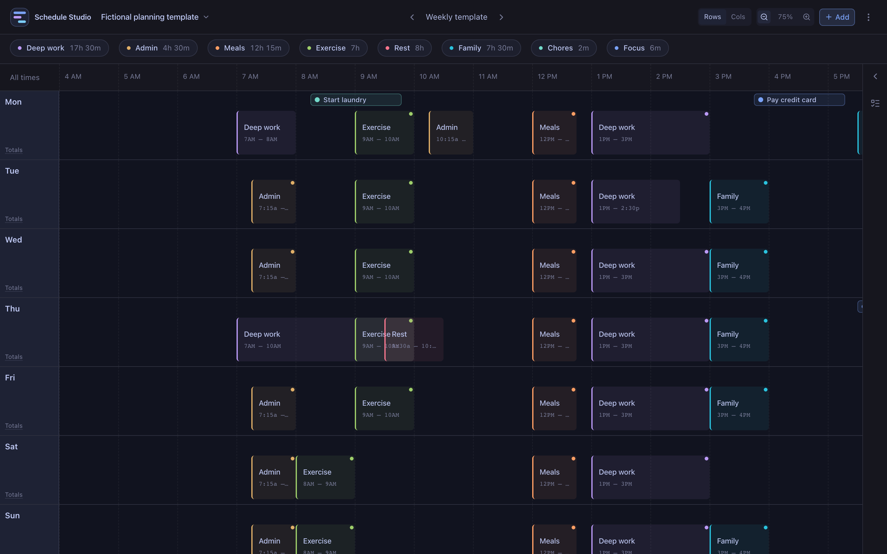
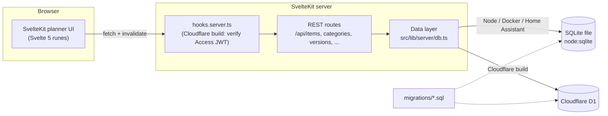

# Schedule Studio

[](https://github.com/TaylorFinklea/schedule-studio/actions/workflows/ci.yml)
[](LICENSE)

Schedule Studio is a self-hosted weekly planner: drag time blocks onto a timeline, tag them with categories, and see weekly totals per category against your targets. It's local-first and single-user (one SQLite file, no account) and runs as a Docker container, a Home Assistant add-on, or on Cloudflare Workers + D1.

**Try it:** a live demo runs on my projects site at [projects.finklea.dev](https://projects.finklea.dev/projects/schedule-studio) ([full screen](https://projects.finklea.dev/demo/schedule-studio)). The demo uses fictional data and keeps your edits in your own browser.



## Architecture



The planner is one SvelteKit app. The server loads a week view, the page sends edits to small REST handlers, and those handlers call one hand-written SQL data layer. A build flag (`SCHEDULE_STUDIO_TARGET=cloudflare`) switches the adapter and storage backend.

### Three biggest design decisions

1. **No built-in login.** It's a single-user app, so instead of building accounts it relies on whatever sits in front of it:
   - Home Assistant Ingress.
   - A reverse proxy that handles sign-in.
   - On Cloudflare, Cloudflare Access, plus a check in the app that **fails closed**: the Worker verifies the signed Access token's RS256 signature, issuer, audience, owner email and hostname, and refuses the request if any setting is missing.

   The trade-off: a plain Docker install is open to anyone who can reach it, which the [security model](#security-model) spells out.

2. **One data layer, two databases, no ORM.** The Node build uses Node's built-in `node:sqlite`, so there's no native module to compile and the Docker image stays simple. The Cloudflare build uses D1. Both use the same raw SQL schema migrations and hand-written queries; only the fictional starter data is loaded differently. I chose this over an ORM to keep both databases' behavior visible and consistent. The cost is writing SQL by hand.

3. **Time is integer minutes; a schedule version is a copy.**
   - Every time is stored as minutes since midnight (0–1440), and edits snap to 5 minutes, which keeps overlap and total calculations simple.
   - A "schedule version" is just another template row. Creating one copies its day bounds and items in a single transaction, so trying out a new week can never damage the default one.

## How it runs

| Where                   | How                                                                                                                                                                                        |
| ----------------------- | ------------------------------------------------------------------------------------------------------------------------------------------------------------------------------------------ |
| **Docker**              | Image at `ghcr.io/taylorfinklea/schedule-studio` (`linux/amd64`, `linux/arm64`). Data goes in a `/data` volume.                                                                            |
| **Home Assistant**      | Add-on in [`home-assistant/`](home-assistant/schedule-studio/DOCS.md) that uses the same image, opens through Ingress, and stores data in `/data`.                                         |
| **Cloudflare (my own)** | Workers + D1 behind Cloudflare Access, for one owner. See the [runbook](docs/deploy-cloudflare.md).                                                                                        |
| **Public demo**         | The planner UI built into a static page in my separate projects-site repository. It uses a browser-local adapter and fictional data, and has no server, database or Cloudflare connection. |

- **Deploy path:**
  - Every push to `main` and every `v*` tag builds the multi-arch image and publishes it to GHCR, tagged with the `package.json` version and `latest` ([`container.yml`](.github/workflows/container.yml)).
  - Home Assistant pulls the image matching the add-on's version.
  - Cloudflare deploys are manual: `pnpm deploy:cloudflare` builds, then runs `wrangler deploy` using a gitignored production config. The runbook requires a dry run first.
- **CI** ([`ci.yml`](.github/workflows/ci.yml)): every push to `main` and every pull request runs Prettier, `svelte-check`, the Vitest unit tests, a production build, and the desktop Playwright suite.
- **Secrets:** none are stored in the repository.
  - GHCR publishing uses the workflow's built-in `GITHUB_TOKEN`.
  - On Cloudflare, the owner email is a Worker secret set with `wrangler secret put`. The real hostname, Access settings and D1 ID live in a gitignored `wrangler.production.jsonc`, and the committed [`wrangler.jsonc`](wrangler.jsonc) contains placeholders only.

### Security model

Anyone who can reach a Node or Docker server can view and edit its schedule. Run it on a trusted network or behind a reverse proxy that requires sign-in. The Home Assistant add-on is protected by Home Assistant's own login through Ingress. The Cloudflare build checks Cloudflare Access tokens as described above.

## How I know it's healthy

- **Monitoring:**
  - `GET /healthz` returns `{"ok":true}`.
  - The Docker image runs a `HEALTHCHECK` against it every 30 seconds.
  - The Home Assistant add-on's watchdog restarts the app when the check fails.
  - On Cloudflare, Workers observability is enabled.
- **Logs:** the container writes to stdout (`docker logs`, or the add-on's Log tab). Cloudflare deployments use Workers Logs.
- **Alerts:** GitHub reports failing CI and image builds. There's no uptime alerting, which fits a self-hosted personal tool. A hosted, multi-user version would need it.
- **Backups:**
  - Home Assistant backups include the add-on's `/data`, which holds the database.
  - For Docker, stop the container and copy the whole data directory (the database plus its SQLite WAL files): `docker stop schedule-studio && docker cp schedule-studio:/data ./schedule-studio-backup`.
  - D1 offers point-in-time restore through Time Travel.
  - The app has no import/export feature yet; it's on the [roadmap](.docs/ai/roadmap.md).
- **One thing that broke:** the first Home Assistant release (0.1.0) didn't start.
  - The cause: the image ran as the unprivileged `node` user, but Home Assistant mounts `/data` owned by root, so SQLite couldn't create its database file.
  - The 0.1.1 fix removed the `USER node` switch so the app can write to the mount.
  - The trade-off: the container now runs as root. A better fix is an entrypoint that adjusts `/data` ownership and then drops privileges. It's a known follow-up.

## How it was built

I built Schedule Studio with AI coding agents. I made the product and architecture decisions; the agents wrote most of the implementation, tests and docs. Commits that Claude Code wrote carry a `Co-Authored-By: Claude` trailer.

**Review.** My agent working rules keep an AI-written change from being committed on the word of the model that wrote it:

- **Plan review:** larger or ambiguous changes get their plan reviewed by a second model before implementation.
- **Diff review:** every material change gets an adversarial diff review from a model other than the one that wrote it: OpenAI GPT through Codex, or GLM. A fresh Claude reviewer with no part in the implementation also reviews it.
- **My check:** I check each finding against the code. I adopt it or reject it with a reason.

These rules were added partway through the project. Recent commits record the reviews in `Reviewed-by` trailers.

**Testing:**

- Vitest unit tests cover the scheduling math, the SQLite data layer, and the Cloudflare Access check: a forged signature, a different or missing email, the wrong hostname, a missing token, and missing settings.
- `pnpm test:workerd` runs the D1 data layer inside a local `workerd` runtime.
- Playwright tests the planner end to end, on desktop and on a mobile viewport (Pixel 7).
- `svelte-check` handles type checking.
- CI runs all of this except the Workerd and mobile suites.

## Run it yourself

### Docker

```sh
docker run -d --name schedule-studio \
  -p 3000:3000 \
  -v schedule-studio-data:/data \
  ghcr.io/taylorfinklea/schedule-studio:latest
```

Open <http://localhost:3000>. To build the image yourself, run `docker compose up --build`.

### Home Assistant

Add `https://github.com/TaylorFinklea/schedule-studio` as an add-on repository, then install **Schedule Studio**. See [`DOCS.md`](home-assistant/schedule-studio/DOCS.md).

### From source

Requires Node 24+ (for `node:sqlite`) and pnpm 10.

```sh
pnpm install
pnpm dev
```

The first run creates a fictional starter schedule so the interface is usable right away.

| Variable             | Default                         | Purpose                     |
| -------------------- | ------------------------------- | --------------------------- |
| `SCHEDULE_STUDIO_DB` | `.local/schedule-studio.sqlite` | SQLite database path        |
| `HOST` / `PORT`      | `0.0.0.0` / `3000`              | Listen address (production) |

Layout and theme preferences are stored in the browser (`localStorage`). Schedule data is stored in SQLite (D1 on Cloudflare).

```sh
pnpm check          # svelte-check typecheck
pnpm test           # Vitest unit tests
pnpm test:e2e       # Playwright (Chromium + mobile; mobile has known failures)
pnpm test:workerd   # D1 data layer in a local workerd runtime
pnpm build          # Node production build
pnpm lint           # Prettier check
```

To deploy on Cloudflare, see [docs/deploy-cloudflare.md](docs/deploy-cloudflare.md).

## License and status

[MIT](LICENSE).

**Status:** v0.1.5. A personal project with one maintainer, in use on my own setup. See the [changelog](CHANGELOG.md) and [roadmap](.docs/ai/roadmap.md).

Known issue: on phone-width screens, the sticky day-label column blocks taps on the grid. Six mobile Playwright tests fail because of it, which is why CI runs the desktop suite only.
